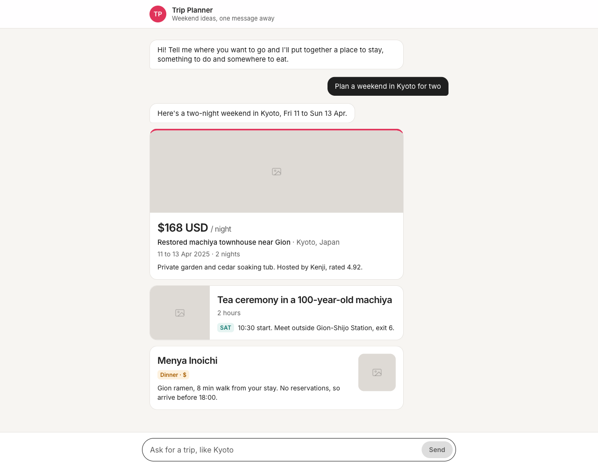

# Trip Planner chat prototype

A chat page where you ask for a trip ("Plan a trip to Kyoto") and the assistant answers with three cards: a place to stay, an experience and a place to eat.



## What it does

1. The page opens with a header, a scrolling thread and a message box with a Send button. The thread starts with a greeting, so it is never empty.
2. You send a message. The message box and Send button lock so you cannot send twice.
3. The assistant's reply bubble shows three pulsing dots while it "thinks".
4. The dots are replaced by the Stay, Experience and Food cards, always in that order.
5. The message box unlocks.

There is no real AI behind this yet. Every request returns the same fixed Kyoto weekend, written by hand as a **mock response** (fake sample data in the exact format a real assistant would send). A short built-in server waits about 2 seconds before answering so the thinking state is visible.

## Run it locally

You need [Node.js](https://nodejs.org) 22 or newer.

```bash
npm install
```

```bash
npm run dev
```

Then open http://localhost:3000.

## Try the error state

Add `?fail=once` to the address: http://localhost:3000/?fail=once

1. Send "Plan a weekend in Kyoto for two".
2. The thinking dots play, then an error bubble appears with a **Try again** button.
3. Tap **Try again**. The same request is sent again and the three cards appear.

Only the first request fails. Every request after it works.

## Card design

Built from the Kyoto Weekend Card Spec. Grey boxes stand in for photos because image rights are not cleared.

| Card | Photo placeholder | Biggest text | Accent colour |
|---|---|---|---|
| Stay | Wide banner across the top | Nightly price | Rose top border |
| Experience | Tall box on the left | Activity name | Teal day labels |
| Food | Small box on the right | Restaurant name | Amber meal and price label |

## Content choices

Card content comes from the Kyoto Weekend Prototype Content Pack (one row per card):

- **Stay:** S1, Restored machiya townhouse near Gion, $168 a night.
- **Experience:** E1, Tea ceremony in a 100-year-old machiya, Sat 12 Apr at 10:30.
- **Food:** F1, Menya Inoichi ramen, dinner.

The weekend comes to $516 for two, under the sheet's $600 budget. Rows left out:

- E3 is sold out.
- E4 is missing its host name, so its other values sit in the wrong columns.
- F4 would push the weekend to $662, over budget.

The Experience card shows one day label for each day the sheet lists. The tea ceremony runs on Saturday only, so it has a single SAT row.

## Where things live

| Path | What it is |
|---|---|
| `app/page.tsx` | The chat page. Reads `?fail=once` from the address. |
| `app/api/plan/route.ts` | The stand-in assistant. Waits, then returns the mock response (or a broken one). |
| `lib/mockResponse.ts` | The Kyoto weekend data, in the spec's response format. |
| `lib/types.ts` | The shape of messages and cards. |
| `components/ChatApp.tsx` | Chat logic: sending, locking, thinking, cards, error and retry. |
| `components/cards/` | The Stay, Experience and Food cards. |
| `app/globals.css` | Colours, fonts and animations. |

## Built with

Next.js 16 (App Router), React 19, Tailwind CSS 4, TypeScript.
